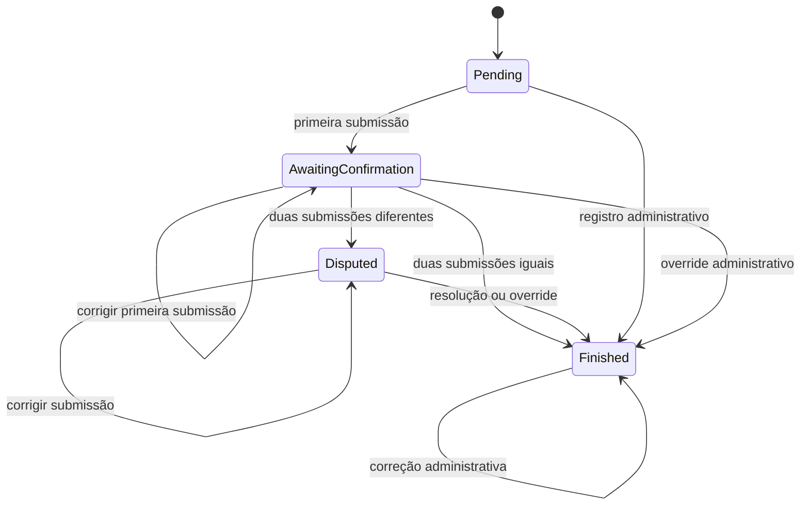

# Milestone 4 — Resultados bilaterais e disputas

O fluxo principal permite que cada equipe informe o placar. Concordância confirma
automaticamente; divergência abre uma disputa para decisão administrativa. O
registro manual anterior continua disponível e compartilha a aplicação de resultado
oficial com os demais fluxos.

## Estados e significado dos dados

ScoreSubmission representa o relato de uma equipe, com IDs, placares, SubmittedAt
e UpdatedAt em UTC. Existe uma única submissão por partida/equipe; uma correção
mantém Id e SubmittedAt, atualiza UpdatedAt e registra os valores anteriores na auditoria.
HomeScore e AwayScore sempre seguem a ordem mandante × visitante, inclusive quando
quem envia é o visitante. A UI identifica os lados pelos nomes retornados pela API.

O resultado oficial fica em Match.HomeScore/AwayScore, com FinishedAt e ResultSource.
Antes da confirmação esses campos de placar e data são nulos. ResultSource é
Bilateral, DisputeResolution ou Manual; resultados anteriores à migration permanecem
com origem nula e são apresentados como administrativos legados.

Uma disputa aberta exige decisão do organizador, mesmo se correções posteriores
fizerem as submissões concordar. Assim a divergência já escalada não desaparece
sem uma decisão registrada. A equipe pode corrigir seu relato enquanto a partida
não estiver Finished; depois disso recebe 409. Uma disputa resolvida não pode ser
resolvida novamente. Não há reabertura de disputa neste milestone.

Somente partidas Finished entram na classificação existente (3/1/0 pontos).
Submissões e disputas não somam pontos. O campeonato só termina quando todas as
partidas estão Finished e não existe disputa aberta. Pendências são calculadas a
partir de AwaitingConfirmation e disputas Open; partidas ainda sem nenhum envio
continuam visíveis na lista de partidas, fora dessa seção.

## Contratos HTTP

| Operação | Endpoint | Corpo |
| --- | --- | --- |
| Criar ou substituir relato da equipe | PUT `/api/matches/{matchId}/score-submissions/{teamId}` | `{"homeScore":3,"awayScore":1}` |
| Resolver disputa | PUT `/api/disputes/{disputeId}/resolve` | `{"homeScore":3,"awayScore":1,"resolutionNote":"Resultado confirmado pela súmula."}` |
| Registro ou correção administrativa | PUT `/api/matches/{matchId}/result` | `{"homeScore":3,"awayScore":1}` |
| Histórico da partida | GET `/api/matches/{matchId}/audit-log` | — |

PUT identifica o recurso estável (partida, equipe) e faz upsert, evitando endpoints
distintos para primeiro envio e correção. Retorna 200 com SubmissionResponse. Uma
repetição antes de finalizar mantém uma única submissão, mas atualiza timestamp e
auditoria. Após finalizar, até um reenvio igual retorna 409.

Os placares são obrigatórios, inteiros de 0 a 2147483647. A nota de resolução é
obrigatória, sem aceitar somente espaços, e tem até 2000 caracteres; é persistida
sem espaços nas extremidades. Resolver retorna 200 com DisputeResponse.

GET de partidas mantém os campos anteriores e acrescenta resultSource, submissions
e dispute (a mais recente, ou null). GET de auditoria retorna uma lista cronológica
com id, matchId, teamId, eventType, occurredAt e data (JSON serializado em string).
Os DTOs aparecem em Swagger/OpenAPI; enums usam nomes textuais como nas APIs anteriores.
Erros seguem ProblemDetails: 400 validação, 403 equipe não participante, 404 recurso
ausente e 409 resultado final, disputa resolvida ou conflito concorrente.

## Identidade e operação administrativa

Não existe autenticação nem autorização de organizador. teamId da rota é a única
identidade declarada pelo chamador: não há outro campo de destinatário no corpo.
O domínio/API impedem submissão de um terceiro time e alteração de uma submissão
de outra equipe sob esse mesmo teamId. **Sem login, qualquer chamador pode declarar
o ID de um dos participantes. Não é possível garantir a identidade real nesta etapa.**
A tela identifica o envio como simulação administrativa e permite escolher ambos
os lados. Futuramente, o controlador deverá obter a equipe do usuário autenticado,
sem aceitar livre escolha pelo cliente, e proteger resolução/override por permissão.

O endpoint manual permanece compatível. Ele aplica resultado oficial com origem
Manual, preserva submissões e fecha eventual disputa aberta com a nota
“Resultado definido por override administrativo.”. Também permite corrigir partidas
Finished, atualizando FinishedAt e a classificação. Na UI está dentro de **Ação
administrativa**, com descrição do efeito. A resolução de disputa tem seu próprio
formulário e exige justificativa. Nenhum desses fluxos apaga o histórico.

## Persistência, concorrência e auditoria

A migration `20261103230252_AddScoreConfirmationDisputes` acrescenta três tabelas,
ResultSource e amplia a restrição de estados de Match. Migrations anteriores estão
intactas. FKs usam IDs; índice único (MatchId, SubmittedByTeamId) impede duplicatas;
índice parcial único em Dispute.MatchId com Status = Open impede duas disputas abertas.
Checks impedem placares negativos e resultado oficial incoerente com o estado.
A validação de participação da equipe ocorre no domínio/API.

Envio, resolução e registro manual usam a mesma ordem de bloqueio: transação,
SELECT FOR UPDATE no campeonato, leitura do estado mutável e gravação. O bloqueio
funciona entre instâncias da API e serializa inclusive resultados de partidas
diferentes no mesmo campeonato para manter correto seu encerramento. Campeonatos
diferentes continuam independentes. GET de partidas usa RepeatableRead para ler
partidas, submissões e disputas em um snapshot consistente.

ResultWorkflow centraliza resultado oficial, fechamento de disputa e encerramento
do campeonato, dentro da transação do controlador. AuditLog é uma tabela simples
na mesma transação, sem event sourcing: ScoreSubmitted, ScoreUpdated,
AutomaticallyConfirmed, DisputeOpened, DisputeResolved, AdministrativeResult e
OfficialResult. Guarda MatchId, TeamId declarado quando aplicável, timestamp e
dados mínimos (placar anterior/novo, origem, ID da disputa ou nota). Eventos do
sistema/organizador têm TeamId nulo: ainda não identificam uma pessoa real.

A migration foi aplicada no PostgreSQL existente, preservando torneios e resultados
anteriores. Não faça downgrade em banco com novos estados sem um plano de dados:
o Down remove as novas tabelas e restaura a restrição antiga de estados.

## Validação e limites

- Builds .NET e Angular aprovados.
- 73 testes backend: participação, validações, correções, confirmação, classificação,
  disputa, resolução, override, auditoria, Swagger e conclusão com várias partidas.
  Incluem envios simultâneos concordantes/divergentes, upserts da mesma equipe e
  resoluções concorrentes, usando PostgreSQL real.
- 24 testes Angular: submissões, pendências, disputas, resolução, erros e proteção
  contra refresh atrasado que fazia a UI retroceder o estado do campeonato.
- 4 testes de navegador com API real: os dois fluxos anteriores, concordância
  automática e campeonato completo com divergência/resolução/persistência.
  Layout de 390 px sem overflow externo; tabelas têm rolagem interna.
- Migration aplicada no banco existente e em bancos novos dos testes.

O download da imagem Docker da API continua limitado pela rede cloud, conforme
[migração .NET 10](dotnet10-upgrade.md). A validação usa SDK .NET 10 e PostgreSQL
via Docker. Não foram acrescentados login, usuários, upload de evidências, IA,
mensageria, pagamentos ou scheduling. A auditoria fica disponível na API; não há
uma tela dedicada ao histórico neste milestone.
