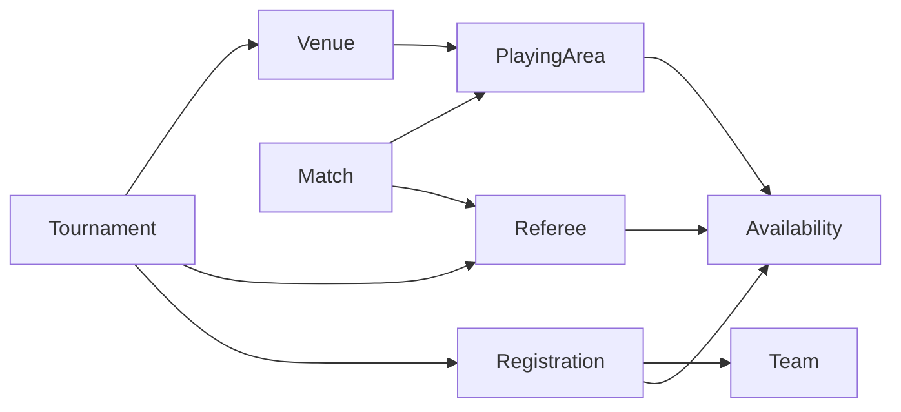

# Milestone 5 — Scheduling Foundation

Disponibilidade e agendamento manual fornecem a base operacional para o futuro
motor de horários. O backend valida todas as reservas; não escolhe horários.

## Modelo e contexto

Venue pertence ao Tournament (sem introduzir Organization). PlayingArea pertence
ao Venue e ao mesmo Tournament. Referee também é específico do campeonato.
Nome e endereço identificam o local visualmente; relacionamentos usam IDs.
Active existe nos três recursos e é verificado ao reservar. Neste MVP o gerenciamento
de recursos permite criação e consulta; desativação, exclusão e compartilhamento
de locais/árbitros entre campeonatos ficam para uma evolução explícita.

Availability contém TournamentId, StartsAt, EndsAt e exatamente uma FK opcional:
TeamId, PlayingAreaId ou RefereeId. Um check exige um único alvo; FKs compostas
garantem o contexto do campeonato, incluindo a inscrição da equipe. Índices únicos
impedem intervalos exatamente duplicados para cada recurso. Uma tabela com três
alvos conhecidos evita tanto duplicar CRUD quanto criar um sistema de recursos genérico.

Disponibilidades são períodos por data real. Recorrência semanal e exceções que
anulam uma recorrência não fazem parte desta etapa. Para várias semanas, cadastre
as datas desejadas. Intervalos sobrepostos são permitidos; duplicatas exatas não.
Uma partida inteira precisa caber em **um** intervalo de cada recurso: dois
intervalos adjacentes menores não são unidos implicitamente.

## Horários e duração

PostgreSQL armazena instantes em `timestamp with time zone`; a aplicação usa UTC.
Requests recebem strings ISO 8601 com offset obrigatório ou Z, por exemplo
`2026-11-14T18:00:00-03:00`. Uma hora sem offset é rejeitada com 400.
Responses retornam UTC. Offsets diferentes que representam o mesmo instante são
comparados como o mesmo horário, inclusive para detectar duplicatas.

Tournament.TimeZoneId guarda um fuso IANA para exibição (ex.: America/Sao_Paulo).
Campeonatos existentes recebem UTC na migration, sem presumir o fuso do usuário.
A agenda Angular usa Intl com esse fuso. Os campos `datetime-local` são identificados
explicitamente como horários no fuso do navegador, convertido para UTC no envio;
ao editar, a conversão é invertida. Isso permite usar a interface em outro fuso
sem reinterpretar a data como se fosse o fuso do campeonato. Horários locais
inexistentes numa transição de horário de verão são rejeitados pelo formulário;
horários ambíguos usam a escolha padrão do navegador. Para selecionar explicitamente
o offset numa ambiguidade, utilize a API. Não há offset brasileiro fixo no código.

MatchDurationMinutes aceita inteiros de 5 a 480, com padrão 60. O servidor calcula
EndsAt = StartsAt + duração vigente. O término é persistido como snapshot: alterar
a configuração não move reservas anteriores. Reagendar recalcula a duração vigente.
Partidas finalizadas não podem ser agendadas/reagendadas; seu histórico é preservado.

## Contratos

Todos os caminhos abaixo usam o prefixo `/api/tournaments/{tournamentId}`,
exceto a operação de agendamento indicada explicitamente.

| Operação | Caminho | Corpo |
| --- | --- | --- |
| GET/PUT configuração | `/schedule-settings` | `{"matchDurationMinutes":50,"timeZoneId":"America/Sao_Paulo"}` |
| GET/POST locais | `/venues` | `{"name":"Ginásio","address":"Rua Central, 10"}` |
| GET áreas | `/playing-areas` | — |
| POST área | `/venues/{venueId}/playing-areas` | `{"name":"Quadra 1"}` |
| GET/POST árbitros | `/referees` | `{"name":"Carlos"}` |
| GET/POST disponibilidade | `/{kind}/{resourceId}/availability` | `{"startsAt":"2026-11-14T08:00:00-03:00","endsAt":"2026-11-14T22:00:00-03:00"}` |
| PUT/DELETE disponibilidade | `/{kind}/{resourceId}/availability/{id}` | mesmo corpo no PUT |
| GET agenda | `/schedule` | — |
| PUT agendamento | `/api/matches/{matchId}/schedule` (absoluto) | `{"startsAt":"2026-11-14T18:00:00-03:00","playingAreaId":"UUID","refereeId":null}` |

`kind` aceita `teams`, `playing-areas` e `referees`. Equipe precisa existir e estar
inscrita; alvo inexistente, de outro contexto ou tipo desconhecido retorna 404.
POST retorna 201, PUT 200, DELETE 204. Validação sintática retorna 400; conflitos
retornam 409 ProblemDetails com o motivo. Agendamento retorna ScheduleDto.

A agenda retorna partidas com IDs/nomes dos dois times, início/fim, Venue,
PlayingArea, Referee e MatchStatus. Ordenação é início cronológico seguido de ID,
com partidas sem horário ao final (campos nulos). A interface agrupa as agendadas
por data e mostra separadamente a contagem das não agendadas. Partidas antigas
finalizadas sem horário são identificadas como tais, sem permitir agendá-las.

## Hard constraints e reagendamento

ScheduleTime centraliza a interseção de intervalos semiabertos `[início,fim)`:
`inicioA < fimB && inicioB < fimA`. Assim 18–19 e 19–20 são compatíveis;
18–19 e 18:30–19:30 conflitam.

A reserva exige disponibilidade integral dos dois times, área e árbitro opcional,
área/local ativos e árbitro válido no campeonato. Impede sobreposição de cada time,
área e árbitro. Times globais também são verificados em outros campeonatos; locais
e árbitros são recursos específicos do torneio. Áreas diferentes do mesmo local
podem receber jogos simultâneos se os outros recursos estiverem livres.

Reagendar ignora a própria Match na busca de conflitos. As verificações precedem
a gravação; erro mantém a reserva anterior. A resposta agrega indisponibilidades
e colisões encontradas, identificando nomes e horários em UTC. Identidades/contextos
inválidos são rejeitados antes dessa agregação. A UI exibe o detalhe da API e mantém
o formulário para correção, sem duplicar as constraints esportivas.

Editar/remover disponibilidade também valida partidas já agendadas: se nenhuma
janela restante contiver uma delas, retorna 409. Reagende primeiro ou cadastre outro
intervalo que mantenha a cobertura. Isso vale também para partidas finalizadas,
preservando a consistência histórica. Ainda não há operação de remover agendamento.

## Transações e concorrência

Todas as escritas de disponibilidade, configuração e agenda adquirem o mesmo
`pg_advisory_xact_lock(771905)` em transação ReadCommitted. A reserva então bloqueia
a linha Tournament com FOR UPDATE, compatível com os fluxos anteriores de resultados.
A leitura de conflitos ocorre depois do lock. O próximo escritor lê o commit
anterior antes de validar, inclusive se forem instâncias distintas da API.

O bloqueio global é deliberadamente simples e conservador para este MVP: protege
também uma mesma equipe em campeonatos diferentes e a corrida entre exclusão de
disponibilidade e reserva. Ele serializa essas escritas; em maior escala deve ser
substituído por locks ordenados por recurso ou constraints de exclusão apropriadas.
As leituras e resultados de outros campeonatos continuam disponíveis. Não basta
consultar e salvar sem esse protocolo. Escritas SQL externas não devem contorná-lo;
as FKs/checks/índices reforçam integridade, mas não substituem o lock de sobreposição.
Na versão atual a API busca partidas dos recursos envolvidos e usa ScheduleTime
para comparar intervalos em memória; índices/consulta de faixa serão evolução de escala.

AuditLog registra MatchScheduled e MatchRescheduled na mesma transação, com reserva
anterior/nova. TeamId é nulo; sem login não há atribuição a uma pessoa real.

## Migration e validação

`20261104103631_AddSchedulingFoundation` acrescenta entidades, índices, checks e
colunas opcionais de Match. Dados e migrations históricos são preservados. Foi
aplicada no PostgreSQL 17 existente e nos bancos isolados de testes; torneios
anteriores continuam com seus estados e recebem duração 60/fuso UTC.

Validação: builds .NET/Angular, 98 testes backend, 31 Angular e 5 E2E. Há testes de
CRUD de disponibilidade, fuso/offset, duração, recursos estrangeiros, confirmação
de resultado preservada, adjacência, colisões, rollback lógico de reagendamento,
auditoria, reservas concorrentes e alteração concorrente de disponibilidade.
Swagger inclui DTOs de configuração, recursos, disponibilidade e agenda.

A limitação de download da imagem Docker da API registrada em dotnet10-upgrade.md
permanece: execução validada com SDK .NET 10 e PostgreSQL via Docker. Não há Python,
FastAPI, OR-Tools, geração automática, soft constraints, IA ou autenticação.
Os endpoints atuais atendem a UI e mantêm os dados que o próximo milestone usará;
nenhum contrato especulativo para o motor Python foi criado.
