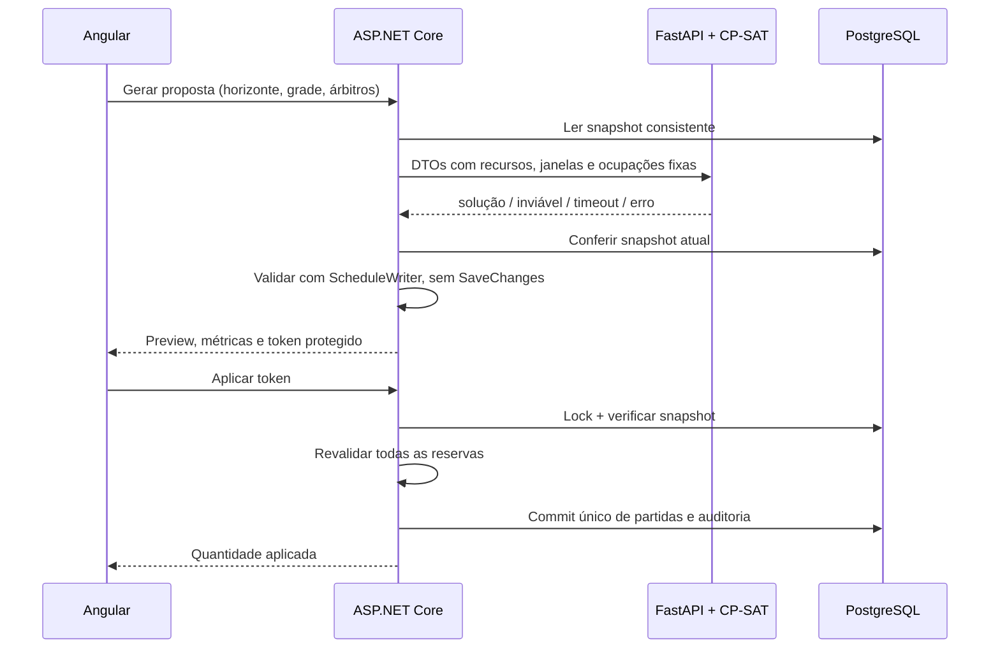

# Milestone 6 — Tournament Autopilot v1

O organizador solicita uma proposta para todas as partidas pendentes dentro de um
horizonte, revisa o resultado e aplica explicitamente. C# continua responsável pela
persistência, regras e autoridade final; Python existe para resolver o problema
com combinatória de horários e recursos usando CP-SAT de verdade.

## Integração das branches e preservação visual

A branch deste milestone integra `feat/scheduling-foundation` em `0b7be2a` e
`style/headerDesign` em `3e77366`, sem alterar main. O merge não teve conflitos
textuais. A branch visual alterava `app.html`, `tournaments.html`,
`tournaments.spec.ts`, `styles.css` e dois SVGs em `public/assests`.
Esses seis arquivos foram preservados integralmente.

A integração inicialmente não compilava: o template e os testes do colaborador
referenciavam modal e formatLabels sem a implementação correspondente no TypeScript.
Foi completado `tournaments.ts`: abertura/fechamento, foco, Tab/Escape, proteção
durante salvamento, atualização da lista após criar e preservação do formulário
em erro. E2E passou a abrir esse modal e entrar pelo card após criar. Nenhum teste
visual foi removido. A base integrada passou em 98 testes .NET, 33 Angular e 5 E2E
antes de acrescentar Autopilot. O novo componente usa as classes existentes na agenda.

## Fluxo e responsabilidades



Python é stateless e não possui conexão com banco, migrations ou conhecimento de EF.
Ele não move partidas já agendadas, inclusive quando compartilham equipes entre
campeonatos. Partidas finalizadas sem horário são excluídas dos alvos automáticos.
Agendamento manual, resultados, disputas e cadastro continuam independentes do Python.

## API pública C#

POST `/api/tournaments/{id}/schedule/generate`:

```json
{
  "horizonStart": "2026-11-14T08:00:00-03:00",
  "horizonEnd": "2026-11-15T22:00:00-03:00",
  "granularityMinutes": 15,
  "requireReferee": true
}
```

O horizonte é obrigatório, com no máximo 31 dias. A granularidade permite 1–60
minutos e o padrão é 15. O modo sem árbitros não atribui nenhum; o modo obrigatório
atribui exatamente um árbitro disponível por partida. Árbitros de partidas fixas
continuam ocupados independentemente da opção.

O retorno `ScheduleProposal` contém status, scheduledMatches, warnings, metrics,
proposalToken e expiresAt. Cada atribuição tem matchId, startsAt, playingAreaId e
refereeId. As métricas contam partidas novas, partidas fixas do campeonato,
período ocupado pelas novas partidas, áreas distintas e árbitros distintos usados.
Preview converte IDs para nomes já carregados pela tela. Proposta vazia não possui
token de aplicação. Erros de validação retornam ProblemDetails.

POST `/api/tournaments/{id}/schedule/apply` recebe **somente**:

```json
{ "proposalToken": "token retornado pela geração" }
```

Resposta 200: `{ "appliedCount": 6 }`. Não há endpoint que aceite atribuições
arbitrárias do navegador como proposta do Autopilot. O endpoint manual anterior
continua disponível e validado separadamente.

GET `/api/scheduler/health` retorna 200 healthy ou 503, consultando o health do
Python. Não impede a inicialização nem as outras operações da API.

## Contrato interno e modelo temporal

`SolverInput` / `GenerateRequest` contém apenas tournamentId, horizonStart,
horizonEnd, matchDurationMinutes, granularityMinutes, requireReferee, matches,
teams, playingAreas, referees e existingSchedule. Recursos contêm id, name e
availability (`startsAt`/`endsAt`); alvos contêm id e IDs dos dois times; ocupações
fixas incluem IDs dos recursos e início/fim reais. Não são entidades EF serializadas.
Os nomes permitem diagnósticos compreensíveis. O fuso de exibição não é necessário
ao solver: ele recebe instantes com offset e opera relativos ao início do horizonte.

CP-SAT usa minutos inteiros. StartsAt = origem + slot × granularidade. Duração é
mantida em minutos exatos: uma partida de 50 minutos não vira 60 numa grade de 15.
Disponibilidades com segundos são arredondadas para dentro; ocupações fixas para
fora, conservadoramente. Isso pode restringir uma solução subminuto, nunca liberar
uma colisão. Timestamps com offset são convertidos para UTC no C#; a UI informa
o fuso do navegador nos campos e usa o fuso do campeonato no preview.

Cada partida tem um início, intervalo obrigatório para cada equipe e intervalos
opcionais por área e árbitro. ExactlyOne escolhe uma área e, quando exigido, um
árbitro. O domínio de início fica contido em uma janela integral de cada recurso.
NoOverlap é aplicado às equipes, áreas e árbitros, incluindo intervalos fixos.
Intervalos são semiabertos, portanto 18–19 e 19–20 são compatíveis. Não há soma
implícita de duas janelas menores. Não há função objetivo esportiva nem soft constraints.

O solver usa um worker, seed zero e ordenação de IDs para execução previsível.
Com o mesmo pacote/ambiente e tempo suficiente, testes verificam determinismo;
limites de tempo próximos do necessário podem variar conforme a máquina.

| Status | Significado |
| --- | --- |
| optimal | CP-SAT concluiu com solução; sem objetivo de qualidade nesta versão |
| feasible | solução válida encontrada |
| infeasible | impossibilidade provada no horizonte e grade solicitados |
| timeout | limite atingido sem solução; não prova impossibilidade |
| error | erro do modelo/cálculo, sem proposta aplicável |

Uma impossibilidade retorna 200, lista vazia e diagnóstico. Janelas insuficientes
de times/áreas/árbitros são identificadas quando possível; outros conflitos recebem
orientação para ampliar disponibilidade/horizonte ou reduzir a granularidade.
Isso não é uma explicação mínima formal de insatisfatibilidade.

## Proposta protegida, aplicação e concorrência

ASP.NET Data Protection autentica e cifra um envelope com campeonato, parâmetros,
atribuições, hash SHA-256 do snapshot e expiração em dez minutos. O navegador não
pode alterar o conteúdo sem invalidar o token. Tokens de outro campeonato ou
adulterados retornam 400; expirados ou desatualizados, 409.

As chaves ficam fora do Git (`.keys` local ou `ProposalKeysPath` configurável).
Compose usa volume `proposal-keys` montado em `/keys`, gravável pelo usuário não
root da API. Instâncias precisam compartilhar o mesmo key ring/ApplicationName.
Apagar as chaves invalida propostas existentes. Não há tabela de propostas nem
migration nova. O token não é autenticação de organizador; o MVP continua sem login.

O snapshot inicial é lido em RepeatableRead. A chamada externa ocorre fora da
transação e sem manter lock de banco enquanto o solver calcula. Antes de entregar
o token, a API adquire o lock de scheduling, confirma o snapshot e valida os
resultados com **o mesmo ScheduleWriter do fluxo manual**, sem SaveChanges.

Apply adquire `pg_advisory_xact_lock(771905)` e FOR UPDATE no campeonato. Compara
novamente o snapshot de configurações, times, recursos, disponibilidades, partidas
e ocupações relevantes em outros campeonatos. Mudanças até fora do horizonte podem
invalidar conservadoramente a proposta. Alteração revertida exatamente ao mesmo
conteúdo representa novamente o mesmo snapshot; não há um contador de revisões.
Cadastros de recursos também participam do lock de scheduling.

Depois da comparação, valida todos os alvos, unicidade/completude, horizonte/grade,
modo de árbitros e constraints do ScheduleWriter. Reservas já preparadas em memória
participam da validação das seguintes. Só após validar todas há um SaveChanges e
commit, incluindo AuditLog MatchScheduled. Qualquer falha aborta tudo. Duas
aplicações simultâneas: a primeira pode vencer, a segunda encontra snapshot alterado
e recebe 409. O replay não sobrescreve partidas existentes.

## Resiliência e limites

- Prazo CP-SAT: 5 segundos. HttpClient: 10 segundos por padrão, configurável por
  `Scheduler__TimeoutSeconds` (1–60). Resposta HTTP limitada a 1 MiB.
- Serviço offline: 503; timeout de transporte: 504; contrato/resposta inválidos: 502.
  Nenhum desses casos interrompe a API principal. Não há retry automático de solver.
- Até 200 alvos, 100 áreas, 100 árbitros, 1000 janelas por recurso, 10000 janelas
  totais, 20000 ocupações fixas e 31 dias. São limites do Autopilot v1, não do manual.
- Logs Python registram tournamentId, quantidades, duração e status, sem payloads completos.
- API e Python seguem restritos a localhost no Compose de desenvolvimento. O
  scheduler é interno; publicação externa/autenticação não fazem parte desta entrega.
- Não há reordenação automática de partidas existentes, fairness, resiliência,
  negociação, notificações ou geração de linguagem natural.

## Validação

117 testes .NET com PostgreSQL (incluindo integração HTTP simulada para falhas,
proposta, aplicação, concorrência e revalidação), 14 testes Python com CP-SAT real,
40 testes Angular e 8 E2E com C#, FastAPI e PostgreSQL reais. E2E cobre aplicar
cinco partidas ao redor de uma fixa, inviabilidade e snapshot alterado. O layout
de 390 px e os assets/header do colaborador foram preservados. Ruff e builds
Angular/.NET também são verificados.

Compose inclui db, migrate, api e scheduler, com healthcheck Python. A imagem
Python foi construída com CA temporária do proxy, executada como usuário não root
e validada saudável pelo Compose e pelo endpoint de saúde C#. Os E2E também foram
executados contra esse contêiner. A validação
completa da imagem API continua sujeita ao bloqueio de rede documentado em
dotnet10-upgrade.md. O serviço Python pode ser executado separadamente; comandos
em [scheduler/README.md](../scheduler/README.md).
