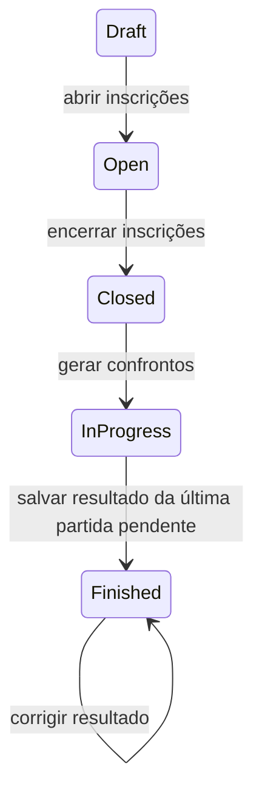

# Milestone 3 — Partidas, resultados e classificação

## Compatibilidade e ciclo de vida

Os estados existentes não foram renomeados: `Draft → Open → Closed` continua
controlando inscrições pelo endpoint original. Novos estados foram acrescentados:



`InProgress` e `Finished` são controlados pelas operações de partidas, e não por
uma chamada arbitrária de alteração de status. Inscrições continuam fechadas em
ambos. Não há reabertura, cancelamento ou remoção de partidas neste milestone.

## Confrontos

`POST /api/tournaments/{tournamentId}/matches/generate` retorna 200 com a lista de
partidas. Na primeira geração, exige RoundRobin, estado Closed e pelo menos duas
equipes inscritas. Para N equipes, cria N × (N − 1) / 2 partidas, todas Pending.
Cada par é formado uma única vez, com IDs das equipes em ordem canônica. A ordem
dos pares é determinística; IDs e timestamps das novas partidas são gerados.
Mandante/visitante apenas identificam os lados do placar, sem vantagem esportiva
ou significado de local nesta etapa.

Repetir a operação devolve as mesmas partidas, inclusive depois de registrar
resultados, sem recriar IDs, apagar placares ou mudar o estado do campeonato.
Inscrições abertas, menos de duas equipes ou outro formato retornam 409.
`SingleElimination` continua aceito no cadastro por compatibilidade, mas não gera
confrontos nem classificação neste milestone.

`GET /api/tournaments/{tournamentId}/matches` retorna a lista ordenada, incluindo
nomes das equipes, status, placares e timestamps. Campeonato sem partidas retorna
lista vazia; campeonato inexistente retorna 404.

## Resultados

`PUT /api/matches/{matchId}/result` recebe:

```json
{ "homeScore": 3, "awayScore": 1 }
```

Os dois placares são obrigatórios, inteiros de 0 a 2147483647. O placar válido
substitui o anterior, coloca a partida em Finished e atualiza FinishedAt em UTC.
FinishedAt representa o último registro/correção, não preserva a hora do placar
original. Repetir um resultado é seguro para os totais, pois eles são derivados.

Quando todas as partidas estão Finished, o campeonato também passa para Finished.
Correções continuam permitidas após o encerramento e recalculam a classificação.
Em correções concorrentes, vence a última gravação concluída sob o bloqueio do
campeonato. Não há histórico de placares, confirmação bilateral ou disputa ainda.

Uma partida possui apenas Pending e Finished, os estados realmente utilizados.
Não há atribuição de data, horário, quadra, local ou árbitro.

## Classificação

`GET /api/tournaments/{tournamentId}/standings` retorna todas as equipes inscritas,
com zeros quando ainda não jogaram. Só partidas Finished entram no cálculo.
Vitória vale 3, empate 1 e derrota 0 pontos.

A ordem é pontos, saldo e gols pró, todos decrescentes, seguida por nome ordinal
sem distinguir maiúsculas/minúsculas; em empate, nome ordinal e TeamId garantem
resultado estável até quando duas equipes têm o mesmo nome. Totais de gols usam
inteiro de 64 bits para evitar overflow na soma de placares válidos.

A classificação é um modelo de leitura calculado; não possui tabela própria.

## Integridade e concorrência

A migration AddTournamentMatches adiciona Matches e substitui o índice único de
Registration por uma chave alternativa com a mesma unicidade (TournamentId,
TeamId). FKs compostas de cada lado da partida apontam para essa inscrição,
garantindo que ambas as equipes pertencem ao campeonato. Uma FK adicional aponta
para Tournament; as inscrições já referenciam Team.

O banco exige HomeTeamId < AwayTeamId e um índice único do trio campeonato/equipes,
impedindo confronto contra si mesmo e duplicidade inclusive com lados invertidos.
Checks também mantêm placar/timestamp consistentes com o estado da partida.

Geração e gravação de resultado usam transação e SELECT FOR UPDATE no campeonato.
Isso serializa alterações daquele campeonato entre instâncias da API, evita duas
gerações simultâneas e impede que resultados concorrentes deixem o campeonato
em andamento após a última partida. Outros campeonatos continuam independentes.
Não foi introduzido repository, MediatR, CQRS ou infraestrutura de mensageria.

## Interface e validação

Os detalhes do campeonato agora incluem partidas, edição/correção de resultado e
classificação. Após gravar um resultado, a UI recarrega os dados da API e o estado
do campeonato. Loading, vazios, conflitos e placares inválidos usam o padrão de
feedback existente; os campos são preservados quando salvar falha.

Validação realizada:

- Build backend e build Angular aprovados.
- 51 testes backend (25 anteriores preservados), com PostgreSQL real.
- 16 testes Angular, incluindo geração, resultados, validação e atualização da classificação.
- 2 testes de navegador: o fluxo principal foi ampliado até conclusão e correção,
  com recarga da página, e o cenário de fechamento concorrente foi preservado.
- Swagger validado por teste HTTP para os novos endpoints.
- Migration aplicada no banco existente; migration inicial intacta e registros
  anteriores preservados. Os testes também aplicam ambas em bancos novos.
- Tela pequena (390 px) verificada; tabelas permitem rolagem horizontal interna.

A limitação prévia do build da imagem Docker por política de rede continua
registrada em dotnet10-upgrade.md; este milestone foi validado com SDK .NET 10 e
PostgreSQL via Docker. Nenhum recurso de scheduling, autenticação, integração ou
resultado bilateral foi acrescentado.
